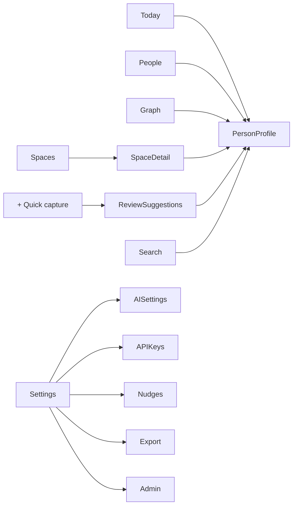

# FolkBook — UI Flows

Screens, flows and interaction ideas to design in Claude Design and then implement.
Status: draft. Update it as decisions change.

---

## 1. Design direction: warm notebook

FolkBook should feel like a **personal address book**, not a corporate CRM.

- **Palette:** warm paper background (cream / off-white), ink-dark text, one accent ink color (e.g. deep blue or burgundy), muted tab colors for spaces
- **Type:** a serif for names and headings (the "handwritten address book" feel), a clean sans for UI and body text
- **Materials:** subtle paper texture, index-card and sticky-note shapes, tabbed dividers, polaroid-style photos
- **Dark mode:** "notebook at night": warm charcoal paper, cream ink. Not pure black
- **Motion:** short, purposeful, physical (paper, ink, tabs). Always respect "reduce motion"
- **Restraint:** the notebook metaphor lives in details, not everywhere. Forms and lists stay fast and plain

---

## 2. Navigation

| | Mobile (bottom tab bar) | Desktop (left sidebar) |
|---|---|---|
| **Today** | ✓ | ✓ |
| **People** | ✓ | ✓ |
| **Graph** | ✓ | ✓ |
| **Spaces** | inside People (filter chips) | ✓ own section |
| **Quick capture** | center "+" button | "Quick capture" button + `Shift+N` |
| **Add person** | from People | `N` shortcut, command palette |
| **Search** | top of People | `Ctrl/Cmd + K` command palette |
| **Settings** | avatar menu | avatar menu |

---

## 3. Flows

### 3.1 First run (server admin)
1. Open the fresh instance → "Welcome to your FolkBook" setup page
2. Create the admin account
3. Create your **Me** profile (name, photo, birthday), shown as the first card in your notebook
4. Optional steps (skippable): import contacts (.vcf) · add an AI key · invite others
5. Land on **Today** with a friendly empty state ("Your notebook is empty, add your first person")

### 3.2 Invite & join
1. Admin → Settings → Users → **Create invite link** (optional expiry, optional email note)
2. Invitee opens link → creates account → creates **Me** profile
3. Same optional steps as first run
4. If the invite came with a shared space, show "Defne shared *Hackathon 2026* with you" on Today

### 3.2a Forgot password
1. Log in → **Forgot password?** With email set up, it sends a reset link to the address in the Email field ("Type your email first." when it's empty) and shows **Check your email** (7a): "If tom@… has an account here, a reset link is on its way", the link works once and lasts an hour, **← Back to log in**, **Send again** ("Sent again. Only the newest link works."). Without email: "Ask your FolkBook's admin for a reset link."
2. The email (7b) has a **Choose a new password** button and the link written out
3. The link opens **Choose a new password** (7c): new password twice → "Password changed", signed out everywhere → Log in. A link that's used, replaced or expired says so, and how to get a new one

### 3.3 Add a person (manual)
1. "+" → **Add person**
2. Minimal form: name (required), photo, pronouns (optional chips: not set · she · he · they), "how we met", spaces (multi-select chips)
3. "More details" expands: work, birthday, contact info, tags
4. Save → lands on the new profile with a hint: "Add something to remember about them"

### 3.4 Person profile (the most important screen)
Top to bottom:
1. **Header:** polaroid photo, name (serif), pronouns if set, "how we met" line, space tabs (shared ones marked with a people icon)
2. **Remember:** memory aids as sticky notes (kids' names, allergies, favorite team…). Add, edit or pin quickly: the pin button on a note (shown on hover or focus, always on touch screens) tacks it to the top, and the first pinned note is the hint on their keep-in-touch nudge on Today. Always private
3. **Notes:** free-form, private
4. **Connections:** relationships list + mini graph; family relations grouped (parents, partner, siblings, derived: cousins, in-laws)
5. **Timeline:** interactions (met, called, coffee…), newest first
6. **Keep in touch:** off / every N weeks / custom (only when nudges are enabled)

Actions: edit · add relationship · log interaction · add to space · open in graph · delete.

For a **shared person you don't own**: basic profile is read-only (or editable with editor role); your notes and memory aids are still yours and private. A small "Shared by Defne · Hackathon 2026" label. **⋯ → Remove from my book…** hides them just for you (Undo for 10 seconds); the space page lists them under "Taken out of your book" with **Add back**.

### 3.5 Quick capture with AI
1. "+" or **Shift+N** → **Quick capture** (`/capture`): a ruled notebook page
   *"Met Tom at the hackathon, designer at Spotify, he's Emma's cousin, likes climbing"*
   - Under it: which AI reads it ("Gemini · gemini-2.5-flash · your key", or "· the server's, set up by Ela"), the phrasing chips ("Coffee with …", "… is …'s sister", "Met … at …") and *Use the form instead*
   - Optional: **Put everyone in a space** (spaces you can add people to)
2. **Suggest** (Ctrl/⌘+Enter): "Reading it back…" with Cancel; after 10 s, "Local models can take a minute." Only the text and today's date go to the AI. A failure says why (key refused, no answer in 90 s, an answer that made no sense, can't reach the address) with *Try again* and *Edit text*
3. **Here's what I read**: one card per suggestion, each with a checkbox, everything editable:
   - **New person:** name, how you met, work; birthday, space and tags as chips
   - **Who is "Emma"?** when only a first name matches: the people it could be (with a detail line), *Someone else: create a new "Emma"*, or search your book. Save waits until each is answered. An exact full name comes already chosen, and can still be someone else
   - **Field changes** on someone you already have: "Emma Yılmaz · Work: Google → Spotify"; greyed out with the reason when you can't make them. Never their spaces
   - **Connection:** the two people, the kind as chips (plus every kind in a list), the kind of parent for parents, the "other family" note for siblings, cousins and the like, and whether it goes in the space (only when both people are in it; the server checks) or stays yours. A link you already have is left as it is
   - **Memory aid** ("Memory aids stay private, even in shared spaces.") and **timeline entry** (kind, day, title, note)
   - Unticking a person unticks everything about them; *+ Add something the AI missed* adds a person, connection, memory aid or entry
   - "4 of 4 selected", *Discard*, **Save 4 items**; Esc or *Edit text* goes back to the text
4. **Save**: everything at once, checked like typed input (one part you can't make, and nothing is saved). Putting new people in a shared space asks first, as Add person does
5. **Saved**: "Added 1 person, 1 connection and 1 memory aid. Emma matched to someone you already had.", who was saved (NEW tags), *Open Tom's page*, *Capture something else*, and **Undo all of this** (only here, right after saving; fields changed again since keep their newer value)
6. **AI is off** (no key of your own, none from the server): what Quick capture needs, *Add a key in Settings →* and *Fill in the form myself*; admins are told they can add one for everyone

### 3.6 Import contacts (.vcf)
A wizard at `/people/import` (Upload · Choose · Duplicates · Space · Done). Nothing is added until the last step.
1. Settings → Import / export → **Import contacts** (onboarding later, once it exists) → drop or choose a `.vcf`
2. **Choose:** the file's contacts, all unchecked ("select who you actually know"), with a search, "Maybe in your book" on possible matches and "Hide N already in your book"
3. **Duplicates** (only if any): one at a time, "Looks like Anna K. already exists", the reason, both sides compared with what a merge adds in blue → **Merge** (only into your own people) / **Skip** / **Import as new**
4. **Space** (optional) for the new people; a shared space asks first
5. **Done:** "Imported 5 new people, in Work · 1 merged into Anna Kowalska · 208 left out" → Later / **Fill in the blanks** (card-by-card: "How do you know Anna?", a space chip, Friend of…, a memory aid; swipe on mobile, keys on desktop). People not filled in are found later under the **Needs details** filter (no Today reminder), which also has a **Fill in the blanks** button for everyone without "how we met". The mode (`/people/fill-in`) reads its list once, shows Done / Now on desktop, and after a full page of 50 offers to keep going.
6. **Recent imports** (Settings → Import / export, the last five): "contacts.vcf · 8 Oct 2026 · 5 people added" (or "· undone"). **Show these people** opens People with a clearable "From contacts.vcf" chip. **Undo this import…** asks first: "3 people go", "1 you've written about since stays", "1 person you had loses the details this import added", each with names; anything changed since stays. Then "Import undone" with Undo for ten seconds.

### 3.7 Spaces
- **Create:** name, color/tab, optional description. Private by default
- **Add people:** from the space page, from a profile, or by multi-select in People
- **Share:** Space → Share → pick users on the server → role (viewer / editor) → first-time explainer:
  *"Members will see these 12 people's basic profiles and this space's links. Your notes and memory aids stay private."*
  The dialog also has the contact-details toggle (off by default) and lists members with a role picker; the space page shows "Who sees this space". Only accounts on this server
- **Adding someone to a shared space:** first-time confirmation ("Tom will be visible to 4 people", with who they are) and "Don't ask again" for that space, remembered on the device
- **Shared indicator:** people icon on the space tab everywhere it appears
- **Leave / unshare:** a member leaves from the space's ⋯ menu (a dialog lists who they'd keep a copy of); the owner removes a member from the member's ⋯ in "Who sees this space", or picks ⋯ → Stop sharing. People they wrote notes on become their own kept copies (§3.14)

### 3.8 Relationships
1. Profile → Connections **+ Add** → pick person (search, or create someone new by name) → pick type
   - Family: parent of / child of (then biological / adoptive / step), partner. Siblings, cousins, in-laws are derived from these
   - Other family, for when the connecting people are unknown: sibling, cousin, grandparent, grandchild, aunt / uncle, niece / nephew. Stored as a direct link; once the parents are added, the derivation explains it
   - Social: friend, colleague, classmate, met at…, custom
2. Optional: start date, which space the link belongs to (defaults to a space both people share; "No space" keeps it private)
3. The **⋯ menu** on a link you made: Change type (same two people), Open their page, End this relationship…, Reopen (a former link), Remove the link (with Undo)
4. **Ending a relationship** (divorce, left a job): end date or "Don't know" → status becomes *former*. The dialog lists who moves to "Former" with it (e.g. in-laws); derived in-laws update automatically. Parent links never end. Undo reopens it

### 3.9 Graph view
- **Default:** you ("Me") pinned in the center, people around, clustered and colored by their first space (each space's ring and name in its own color); former links dashed. Being in a space draws no line (the ring shows it; a line from you to everyone in your spaces read as a relationship you don't have); between users who share a space a faint dotted line. A line's words (the relationship, or "shares Hackathon") show only on the lines of the person you point at or select, or on the one line you point at or tap (anywhere within a few pixels of it: the lines are too thin to hit exactly) (their lines and people light up); on every line at once they piled up on the names. The graph fills the screen under the header and filters; what the colors and clicks mean is behind an ⓘ button by the zoom buttons, hidden until asked for
- **Filter bar:** space chips (any number), "Family only" (family links and the people on them), "Hide former"
- **Click a node:** desktop opens the same peek panel as People; phones get a bottom sheet (name, how you met, a memory aid → Open profile · Focus · How do I know them? · Log). Click the canvas to close
- **Focus mode:** *Focus* in the peek panel (desktop) or the phone sheet shows only that person and the people one or two steps away. A bar: *Back to everyone* (also Esc, after an open peek closes) · "Focused on Emma Yılmaz" · *1 step* / *2 steps* (a new focus starts at 1). Under it the count line, "8 direct · 5 more at 2 steps · 135 others hidden" (the middle part only with 2 steps; you count like anyone else); "Nobody else is connected to Anna yet." for someone with no links; "This person isn't in your book anymore." for someone gone. The focused person stays drawn whatever the filters say. Focus is in the URL (`?focus=`, `&hops=2`) and replaces a route. No double-click (removed: easy to trigger by accident)
- **"How do I know…?":** a box under the header (`/` focuses it on desktop) finds someone in your book; so do *How do I know them?* in the peek panel and the phone sheet, and "How do I know Emma?" under a profile's Connections (not for your own Me). The route from your Me is drawn in ink a step at a time (all at once with reduced motion); its people and lines stay drawn whatever the filters say, everything else dims, and the view fits it. A card over the graph (a sheet on phones) spells it out: "How you know Tom · 2 steps", each step worded like the graph's lines ("friend", "shares Hackathon 2026", "in Hackathon 2026"), why someone else's person is in your book ("Tom came into your book with Hackathon 2026, shared by Defne."), up to two other routes ("Also via Emma Yılmaz: friend, then cousin" · *Show*, then *Back to the shortest*), *Open Tom's profile* · *Clear*. With no route: "You haven't said how you know Anna yet." and *Connect…*; someone gone: "This person isn't in your book anymore." Clear, the box's ✕ or Esc ends it (Esc closes an open peek first). The route and focus are in the URL (`?how=`, `?focus=`) and replace each other
- The graph appears where its layout ends up, with no animation: animated, the lines swung round as people flew out from the middle
- Zoom in / out / Fit buttons; empty graph: "Your graph starts with you"
- **Big notebooks** (more than 300 people; 3j): the network starts with you and everyone within 2 steps along drawn lines (being in a space isn't a step); everyone else is folded into one bubble per space, by their first space ("Climbing club · +212 more"; "Not in any space"), joined by faint "via N" lines from the people who link in. A banner over the graph says "You + 2 steps · 58 of 900 · faraway spaces are folded — click one to unfold" (pointing at a bubble: "Unfold Climbing club · 212 people · you know 3 directly") with **Show all 900**, which this device remembers (then "Showing all 900" with **Fold faraway spaces**). Clicking a bubble unfolds it until the next visit; while spaces are unfolded the banner lists them ("Unfolded: Climbing club ✕"), ✕ folds one back, and **Fold faraway spaces** goes back to how the graph started (all folded, also after Show all); picking spaces in the filters shows everyone in them (whatever their first space) while picked, and hides the other bubbles. A route's people always show. Focus mode doesn't fold (the folded view stays while its people load), and has no banner

### 3.10 Family tree mode
- **Getting there:** "Network / Family tree" in the Graph header ("Network / Tree" on phones) opens your own tree, or the tree of the person open in the peek; **View family tree** under a profile's Family opens theirs. The tree is in the URL (`?tree=`) and replaces a route or a focus; Network (or Esc, after an open peek closes) goes back
- **Who's in it:** everyone linked to that person by family, as far as the links go: blood family, their partners, step-parents and step-siblings; with **In-laws** on, everyone else's partners and the family of their own partners (never through a second marriage); with **Former partners** on, anyone only there through a partnership that ended. Both toggles are on by default and only filter
- **Layout:** one row per generation, labelled ("Grandparents", "Your generation" or "Nilgün's generation", "Children", "3 generations up"), partners side by side, children under their parents. Under each name, how they're related: the words the profile's Family uses, or a chain ("grandmother's cousin"), or "relative" past three steps
- **Lines:** a couple's children come from between them; ended partnerships are dashed ("former"); adoptive and step parent links say so on the line; direct "other family" links are dotted. A key sits bottom left
- **Header:** **Tree of** (change it to re-root the tree) · Former partners · In-laws · "How do I know…?" (shows the route in the network); "Family · 13 people" beside the title and "2 generations up · 1 down" above the tree
- **Clicking someone:** the same peek (phones: sheet) as the network, with **Show their tree** instead of Focus
- **Empty slots:** the person and their ancestors with fewer than two parents get dashed "Add parent of Nilgün" slots; tapping one opens the connection dialog with Parent chosen. Someone with no family yet: "No family linked to Anna yet." with **Connect…**
- Drag to pan, wheel or pinch to zoom, + / − / Fit; the tree fits itself when it opens and appears in place, without animation

### 3.11 Log an interaction
- From profile: **Log** (or `L`) → type (met, call, message, event, other) → date (today, yesterday or any earlier day) → time (optional) → note
- **Turn selection into a memory aid:** puts the words selected in the note on a sticky note, added when the entry is saved; with nothing selected it says to select some first
- When changing an entry, **Delete** sits at the bottom left
- One-tap logs from Today (*Wish*, *We talked*) record the time too
- Saving shows an Undo toast (undo also removes sticky notes made from the note)
- Tap an entry on the timeline to change or delete it; deleting also has Undo
- From Today's nudge card: one-tap "We talked" → optional note
- Logging an interaction resets that person's keep-in-touch timer

### 3.12 Today (home screen)
Sections, each hidden when empty; with nothing at all, an empty state (Add someone · Quick capture). Dates come from the device, so "today" follows the user's time zone.
1. **Birthdays** (today and the next 7 days): "Turns 34 today" → *Wish* logs "Birthday wishes" in one tap (Undo)
2. **Keep in touch:** nudge cards (see DECISIONS for when someone is due), with a pinned memory aid as a hint → *We talked* (logs "Talked" today) · *Snooze* (a week) · *Stop*; each with Undo
3. **Remember?** a random memory aid on a sticky note → *Show another*
4. **Sharing ended:** people who left your book because of someone else, and who you kept (§3.14)
5. **Shared with you:** spaces others shared with you → *Open space* · *Dismiss* (remembered on this device)
6. **Fill in the blanks:** people without "how you know them" → *Start with Anna →* · *See all*
7. **Recently added:** people added to your book in the last 30 days

### 3.13 Search
- One search over names, how you met, work, tags, spaces, and your own notes and memory aids (only what you can see; accents and case don't matter)
- Results grouped: People, Spaces, Memory aids, Notes (with the words around the match), then pages and actions
- Nothing found: "Nothing matches …", a "Did you mean" for a close name, and "Add “Tahir” as a new person" (opens the form with the name filled in)
- Desktop: `Ctrl/Cmd + K` palette; phones: the same as a Search page (button on Today)

### 3.14 Access revoked
- When someone else ends your access (stops sharing, removes you, deletes the space, or takes out or deletes someone you wrote about): a toast once per account (not again on your other devices) + a Today card until dismissed:
  *"Defne stopped sharing Hackathon 2026. You kept 3 people you had notes on."* with the kept people, *Review kept people* · *Dismiss*
- When you leave yourself, the toast says who you kept
- Kept people become your own copies: marked **Kept** on their profile with *"Kept copy · was shared by Defne in Hackathon 2026 until 22 Sep 2026"* and *Add to a space*; People has a **Kept** filter while you have any

### 3.15 Settings
- **Profile & account:** Me profile, password, sessions
- **AI:** a line saying what Quick capture uses ("your own key · Gemini · gemini-2.5-flash", "the server's AI, set up by Ela · …", or "AI is off"). **Only for you:** provider (Gemini / OpenAI-compatible with its base URL), API key (saved ones show as "•••• 3f9a" with Replace; one the server can't read anymore asks to be entered again), model with *Fetch models*, *Test connection* ("Connected · gemini-2.5-flash answered in 640 ms", or why not: refused key, missing model, can't reach it, with a hint about `localhost` inside Docker), Save, Remove (asks first). **For everyone on this server:** the same form for admins; everyone else sees what the server uses, or "No server AI. Your admin can add one, or add your own key above."
- **API keys** (right after Profile & account): a table on desktop, cards on phones: the name with `fb_…14k42`, read-only / read-write (+ private notes), "All spaces" or the space names ("No spaces left" once they're gone), last used ("2 hours ago" / "Never used"), expires ("Never", a date, "Expired")
  - **+ Create key:** name, Read-only ("Look up people and links") or Read-write ("Also add and edit people"), spaces or All spaces, private notes off by default, expires in 30 days / 90 days / 1 year / Never
  - **Key created:** shown once with Copy ("Copied ✓"; without a clipboard it selects the key), its scope in one line, when it expires and "Use it as `Authorization: Bearer …`"; **I've saved it** closes it and the key is gone
  - **Revoke** asks in the row: "Revoke “Birthday script”? Anything using it stops working right away." An expired key has **Delete**, which needs no asking
- **Reminders** (5r): nudges on Today on/off, default interval; **Email digest** Off / Daily ("Every day, 08:00") / Weekly (a day, "Mondays, 08:00"), "Times are in Europe/Istanbul"; **Memory aids** "Include memory aids in emails"; **Birthdays** in the email (leave them out / on the day / 1, 3 or 7 days before); **Send test email** ("✓ Sent to ela@… · 09:14"). Without email on the server: "This server can't send email yet, so reminders only show on Today."
- **Links in the reminder email** (6a): **We talked** opens "Log that you talked with Deniz?" → **Yes, we talked** → "Logged" (or "Already on the timeline"), with Open Deniz's page; **Unsubscribe** opens "Stop reminder emails?" → "You're unsubscribed", with Reminder settings. A link that ran out or lost access: "This link doesn't work".
- **Admin only: Email (SMTP)** (5w): host and port, Security (STARTTLS / SSL / TLS / None), username, password (a saved one shows "Saved" with Replace, and is asked for again when the host or username changes), From, then **Send test email** ("Goes to ela@…", then "✓ Sent to ela@… · 09:14" or why not) and Save; Remove asks first. Set through `FOLKBOOK_SMTP_*` instead → the settings are shown read-only with Send test email. Under it: "Links in emails open https://…". Not set up → for admins, a banner at the top of Settings, "Email isn't set up; reminders only show on Today · Set up email →", and a dot on Email (SMTP)
- **Import / Export:** .vcf import, full export (JSON + photos: "Everything", with how many people and photos and the rough size, and a reminder that it holds private notes), .vcf export, restore
  - **Restore:** "Choose .zip" → the server checks the file (a broken file, one from a newer FolkBook, or a shared book is explained right under the button) → "Replace everything in your book?" shows whose book the file is, its people, spaces and photos, and how many people you have now, with **Download a copy of your book first** (the full export) → type your email to turn Restore on → toast "Your book is restored"
- **Appearance:** light / dark / system, reduce motion
- **Admin only:** users, invite links, server info

---

## 4. Screen inventory

| # | Screen | Mobile | Desktop |
|---|---|---|---|
| 1 | Setup / first run | full screen | centered card |
| 2 | Invite accept + sign up | full screen | centered card |
| 3 | Log in, forgot password ("Check your email") and a reset link | full screen | centered card |
| 4 | Today | tab | main view |
| 5 | People list (filters, search) | tab | main view + list/grid toggle |
| 6 | Person profile | full page | page or side panel |
| 7 | Add / edit person | full page sheet | modal |
| 8 | Quick capture + review | full page | modal / wide panel |
| 9 | Import (.vcf) + enrichment | multi-step | multi-step |
| 10 | Spaces list + space detail | inside People | sidebar section |
| 11 | Share space dialog | bottom sheet | modal |
| 12 | Add relationship | bottom sheet | popover / modal |
| 13 | Graph (network / family tree) | tab | main view + side panel |
| 14 | Command palette | — | overlay |
| 15 | Settings (all sections) | stacked pages | tabs |

---

## 5. Interaction ideas ("spells")

Inspired by the kind of details collected on [Design Spells](https://designspells.com/), adapted to the notebook theme. Nice-to-haves: the core flows come first.

- **Page turn:** opening a profile from a list feels like flipping to that page (shared-element transition: the card grows into the profile)
- **Ink underline:** saving draws a quick ink stroke under the name / field
- **Sticky notes:** memory aids tilt slightly and "stick" when added; peel animation on delete
- **Polaroid photo:** a newly cropped photo drops into its frame in the person form, with a slight rotation (not on the profile, where the photo already travels with the page turn)
- **Long-press person card (mobile):** radial or popup quick menu: log interaction, add memory aid, open in graph
- **Ink path in graph:** "How do I know…?" draws the path hop by hop like a pen stroke
- **Tabbed dividers:** switching spaces slides the colored fill like a notebook divider. People picks a space with filter chips, not tabs, so the picked chip's fill slides under the others to the next one and the list crossfades
- **Delete = tear out:** profile **⋯ → Tear out of the book…** → a confirm dialog lists what goes with them (connections, your memory aids, timeline and note, the spaces they leave) and warns who in a shared space will stop seeing them, by name ("Bora Kaya will no longer see Deniz there"; past four names, "and N others"), and offers **Download a copy first** (a .zip of just them, see Decisions) → the page tears away and a 10-second Undo toast appears
- **Birthday occasion:** subtle confetti / doodle on a person's profile on their birthday
- **Hand-drawn dividers:** lines between sections and under page titles are drawn in ink, each wavering a little differently (a stable pick per section)
- **Doodle empty states:** hand-drawn illustrations for empty Today, empty graph, no results
- **Easter egg:** tapping your own "Me" polaroid a few times flips it to a hidden back side
- **Reduce motion:** every effect has a simple fade fallback

---

## 6. Decisions & open questions
- [x] No voice input for quick capture (text only)
- [x] Reminders go out by email only (plus the in-app Today cards). Self-hosters configure their own SMTP; the paid hosted version sends through our server
- [x] Profile on desktop: peek side panel from lists/graph + "expand" to full page (full page has its own URL). Mobile is always full page
- [x] Graph default: show everyone when the visible notebook is small (~300 people or fewer); otherwise start with Me + 2 hops, and show other spaces as collapsed bubbles you can expand. "Show all" toggle always available. Tune the ~300 limit after performance tests
